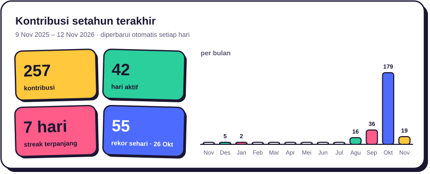
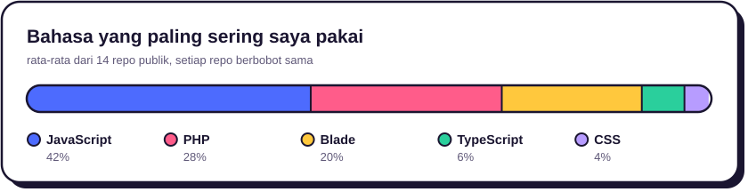

<h1 align="center">Halo, saya Regi Al Habib 👋</h1>

  <b>Fullstack Developer · Laravel &amp; React</b> 
  Senang mengubah ide jadi aplikasi web yang enak dilihat dan gampang dipakai.

  
  
  

---

### Tentang saya

Lulusan S1 Sistem Informasi dari UIN Sultan Thaha Saifuddin Jambi dengan 1+ tahun pengalaman freelance. Sudah menyelesaikan 7+ project untuk 6+ klien, kebanyakan mengubah proses yang masih manual menjadi sistem yang rapi, mulai dari pengajuan dan persetujuan sampai pelaporan.

Project dan screenshot-nya bisa dilihat di [portofolio saya](https://regialhabib-portofolio.netlify.app).

### Aktivitas GitHub

<picture>
  <source media="(prefers-color-scheme: dark)" srcset="assets/stats/kontribusi-dark.svg" />
  
</picture>

<picture>
  <source media="(prefers-color-scheme: dark)" srcset="assets/stats/bahasa-dark.svg" />
  
</picture>

### Stack yang sering saya pakai

  

### Hubungi saya

Terbuka untuk peluang kerja maupun project freelance. Kirim email ke **regialhabib622@gmail.com** atau sapa saya di [LinkedIn](https://www.linkedin.com/in/regi-al-habib-114099424).
